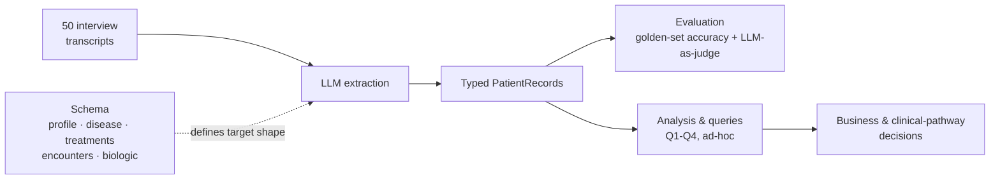
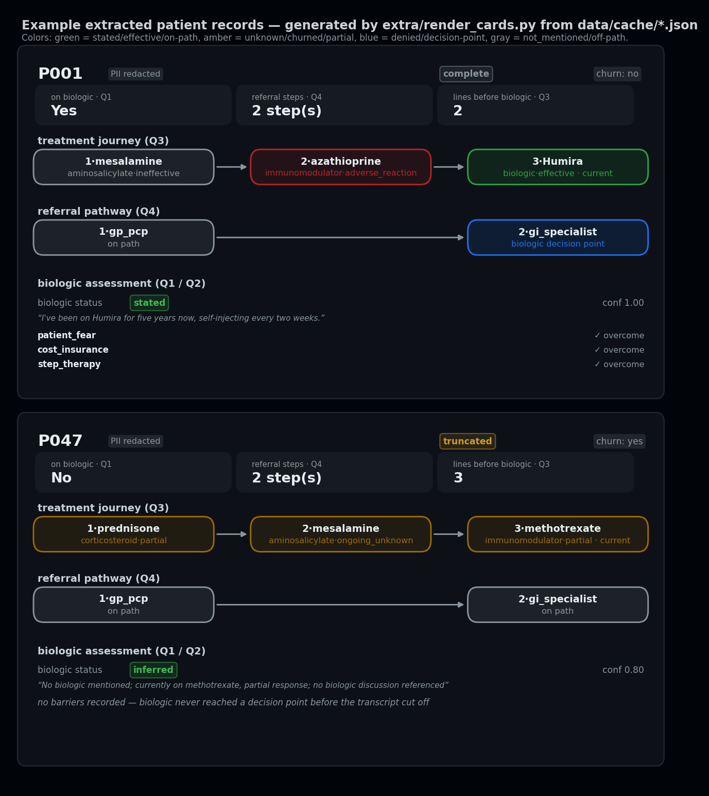
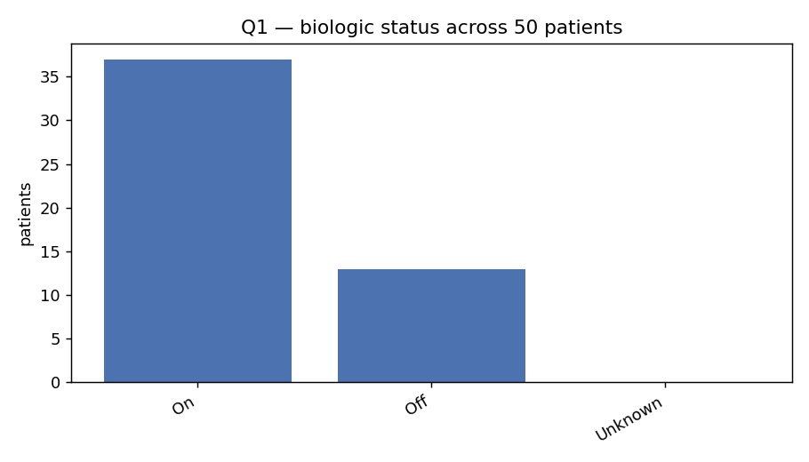
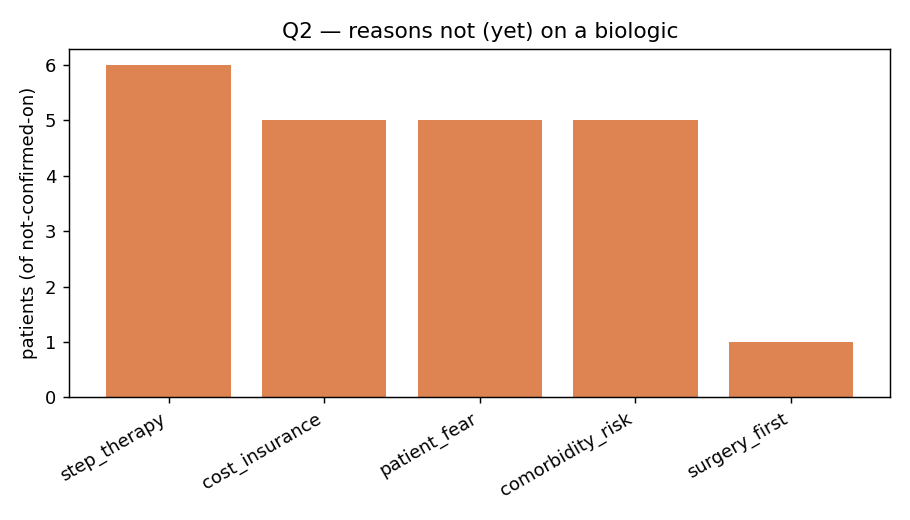
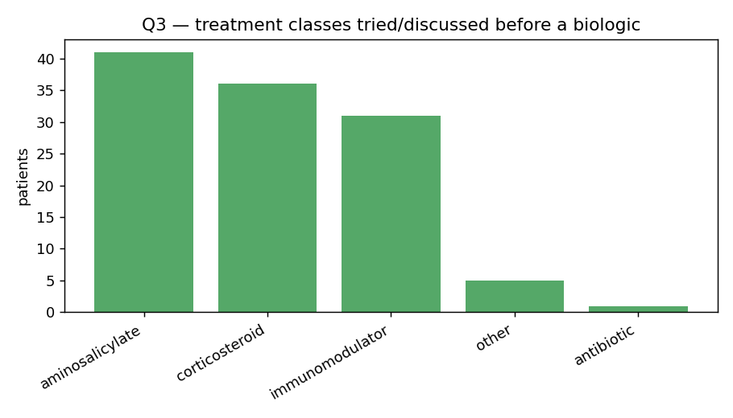
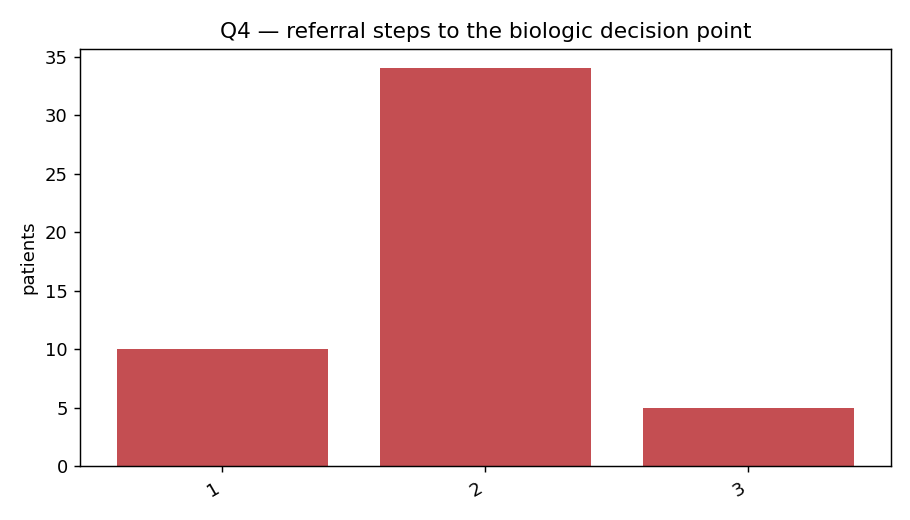

# Crohn's Interview Extraction

> All 50 interview transcripts are synthetic. No real patient data is used.

This is a proof of concept for turning 50 unstructured Crohn's disease patient
interviews into a structured dataset PharmaCorp can query and act on. The system is
made of three components:

- **Schema** — defines what's worth capturing from a transcript and how its
  complexity (uncertainty, contradictions, interviews that cut off mid-thought) gets
  represented in a condensed, structured form, broken into sub-parts per patient:
  profile, disease, treatments, encounters, biologic status.
- **Extraction** — an LLM-based process that reads each transcript and populates the
  schema, plus an evaluation layer (golden-set accuracy, LLM-as-judge) that checks
  how reliable and faithful the result actually is.
- **Analysis & queries** — what the structured records enable once they exist:
  PharmaCorp's four business questions, supporting charts, and open-ended queries
  beyond those four.



The core design choice underneath all three: an LLM is good at reading a messy
transcript and pulling out facts, but not reliable at counting or remembering what it
already said. So extraction (one LLM call per patient, schema-constrained) stays
strictly separate from derivation (plain Python, no LLM, unit-tested) — every number
PharmaCorp actually gets quoted comes from code that can be read top to bottom, not
from asking the model to also do the arithmetic.

Every field is wrapped in the same four-part shape — `value`, `status`, `evidence`,
`confidence` — not just a status label. `status` is one of `stated` (quoted), `inferred`
(reasoned), `denied`, `not_mentioned`, or `unknown_churned` (the interview cut off
before this was resolved), so "the model doesn't know" and "the patient said no" never
collapse into the same blank value. `evidence` is the verbatim quote or reasoning basis
behind `value`. `confidence` is only populated when `status` is `inferred` — a direct
quote (`stated`) doesn't need a numeric confidence to be trustworthy, so that field is
usually left blank for anything actually said outright, and only carries a real number
for the reasoned, less-certain cases.

---

## 0 — Setup & how to run

Requires **Python 3.12.7**.

```bash
python3.12 -m venv .venv && source .venv/bin/activate    # Windows: .venv\Scripts\activate
pip install -r requirements.txt
cp .env.example .env   # then edit .env and add your own ANTHROPIC_API_KEY and/or GEMINI_API_KEY
```

You only need one key, not both — everything below runs against whichever
provider(s) you actually have a key for. Get a free Gemini key at
[aistudio.google.com/apikey](https://aistudio.google.com/apikey); no key, no
extraction (step 1) or judge (step 5) calls will work for that provider.

Run in this order. Only steps 1 and 5 touch a live model / cost anything — 2, 3, 4,
and 6 all run off the committed evidence in `data/outputs/` with **no key and no
API cost**, so a reviewer can see everything below without spending a cent:

```bash
# 1. Extraction — all 50 patients, resumable. Needs an API key and costs real calls.
#    Optional to re-run: data/outputs/records.json below is already the committed
#    result of this step. Only run the Claude line if you have Anthropic credits
#    to spend — Gemini is free-tier and confirmed working end-to-end, so it's the
#    safer default if you're not sure:
python src/run_extraction.py --model gemini/gemini-3.1-flash-lite --cache-dir data/cache_gemini   # Gemini (free tier) -> its own folder
python src/run_extraction.py                                                                      # Claude — only if you have credits, this is a paid call

# 2. Tests — no API calls, no key needed
pytest

# 3. PharmaCorp's four answers + charts, written to data/outputs/ — no API calls, no key needed
python src/analysis.py

# 4. Golden-set accuracy — the model's extraction vs. 10 hand-labeled patients — no API calls, no key needed
python src/evaluate.py

# 5. LLM-as-judge fidelity check (optional — a real API call per patient listed).
#    The golden 10 already have a manual judging pass committed at
#    data/outputs/llm_judge_manual.json, so this step isn't required to see
#    evaluation results; it's here to reproduce or extend it. --model picks
#    whichever provider you actually have credit on:
python src/evaluate.py judge --model anthropic/claude-sonnet-4-6 P001 P002 P047 P048 P015 P031 P004 P038 P024 P045
python src/evaluate.py judge --model gemini/gemini-3.1-flash-lite P001 P002 P047 P048 P015 P031 P004 P038 P024 P045

# 6. Bonus visual patient cards — no API calls, no key needed
python extra/render_cards.py
```

Steps 3, 4, and 6 read `data/cache/` if present, otherwise fall back to the
committed `data/outputs/records.json` — the real evidence from my own run — so all
three reproduce out of the box on a clean checkout. `data/outputs/` ships with
numbers from an earlier point in development; I revised the extraction prompt
after that run (see Extraction below), so those numbers are provisional, not
final. Step 1 rebuilds `data/cache/` under the current prompt, then steps 3–4
overwrite `data/outputs/` for real if you do choose to re-run it.

**Prefer notebooks?** `notebooks/` covers the same ground cell-by-cell, one job per
notebook, in order:

- `00_exploration.ipynb` — transcript stats, word frequencies, length distribution. No API calls.
- `01_pipeline.ipynb` — extraction only: the prompt, the extraction function, the full resumable run for Claude then Gemini in turn (own cache dir each), saving records + CSVs, closing with a Claude-vs-Gemini agreement frame.
- `02_evaluation.ipynb` — golden set for Claude, golden set for Gemini, then LLM-as-judge fidelity for Claude. Reads whatever `01_pipeline.ipynb` already extracted — no extraction happens here.
- `03_analysis.ipynb` — Q1–Q4 via the same `analysis.py` functions the terminal script uses (nothing recomputed), plus the ad-hoc queries from `queries.py` and their supporting charts, all together in one section, closing with every chart gathered in one gallery cell.

Each notebook fixes its own working directory if opened from inside `notebooks/`, so
they run directly in Jupyter/VS Code with no extra setup.

---

## 1 — Schema

A complete interview (P001, on a biologic) next to a churned one (P047, cut off
before the biologic decision point) — same schema, same rendering, real extracted
output for both:



Generated by [`extra/render_cards.py`](extra/render_cards.py) directly from
extracted records — run it yourself for the full set (`python
extra/render_cards.py P001 P047 P048`) or open the live
[`extra/patient_cards.html`](extra/patient_cards.html).

### What gets extracted, and why

Every patient record is built from five pieces, each aimed at a specific question
PharmaCorp — or a follow-up analysis — would actually ask:

- **Profile** (`PersonalProfile`) — age, years since diagnosis, occupation,
  comorbidities. Feeds tenure-based cuts (e.g. "remission rate for patients
  diagnosed >5 years ago") and comorbidity-driven barrier reasoning (Q2).
- **Disease** (`DiseaseProfile`) — location, severity, `disease_control`, and
  symptoms. Symptoms are a fixed clinical vocabulary (`SymptomFlag`), not free
  text, specifically so they double as match-keys: two patients sharing
  `bloody_diarrhea` + `fever` can be grouped and compared, which is exactly what
  `queries.q_best_treatment_for_symptom` does — "of patients with symptom X, which
  treatment class had the best outcomes" is a real question the schema was built
  to make answerable, not just Q1–Q4.
- **Treatments** (`list[Treatment]`) — an ORDERED chain (`sequence_index`), each
  with a normalized `drug_class`, `outcome`, and whether it's `is_current`. The
  ordering is what turns "what did they try before a biologic" (Q3) into a
  deterministic count instead of an LLM guess, and the normalized `drug_class` is
  what makes "of people who tried mesalamine, how many found it useful"
  (`queries.q_drug_usefulness`) a 2-line groupby instead of fuzzy string matching
  on the raw drug name.
- **Encounters** (`list[Encounter]`) — the referral chain, same ordering logic,
  flagged with `biologic_decision_point` (where the chain resolves) and
  `on_referral_path` (so a side-consult dead end doesn't inflate the step count).
  This is Q4.
- **Biologic assessment** (`BiologicAssessment`) — `status`, `barriers` (can be
  more than one — P048 has both `surgery_first` and `cost_insurance`), and
  `drug_name`. This is Q1/Q2 in one place.

The point of keeping these as five separate structured pieces, rather than one flat
bag of fields, is that the interesting PharmaCorp questions are almost all *joins*
across them — symptoms joined to outcomes, tenure joined to disease control,
treatment sequence joined to biologic status — and a join only works if the join
keys (symptom flags, drug classes, `patient_id`) are normalized up front, not left
as free text to fuzzy-match later. See the Analysis section for where these joins
actually get used.

### Handling uncertainty

Every fact is tagged with one of four states via `Status`: `stated` (direct
quote), `inferred` (reasoned, not quoted), `denied` (explicit no), `not_mentioned`
(complete transcript, genuinely never came up), or `unknown_churned` (transcript
cut off before this specific fact surfaced). Two assumptions drive the split:

- **Truncation does not mean "mark the whole record unknown."** A churned
  interview is extracted exactly like a complete one up to the point it stops —
  anything actually said keeps its real status (`stated`/`inferred`/`denied`),
  evidence and all. `unknown_churned` is reserved narrowly for fields the
  narrative was plausibly *about to reach* when it cut off (gated by
  `completeness == truncated`), not applied blanket across the record. A field a
  *complete* interview simply never touches is `not_mentioned` instead — same "no
  value", different reason, and the two are never allowed to collapse into the
  same blank.
- **A present-tense current-meds list is read as exhaustive, not silent.** A
  patient who says "I'm on prednisone and mesalamine right now" and moves on,
  never using the word "biologic", is read as `inferred` `not_on` — the prompt
  treats a present-tense medication list as complete as of the interview, on the
  assumption a patient wouldn't casually omit an injectable biologic from "what
  I'm currently taking." That's an assumption, not a certainty, which is exactly
  why it's `inferred` (carrying a confidence score) rather than `stated` — a
  direct claim like "I'm not on a biologic" would be `stated` instead, no
  inference needed.

Status is set per-field, not per-record: a single truncated interview can still
carry several `stated` facts, one `unknown_churned` field, and one
`not_mentioned` field, all at once (see P047/P048 in the golden set).

### Evidence & confidence (the `Signal` wrapper)

Every extracted field — not just the contested ones — is wrapped in the same
`Signal[T]`: `value`, the `status` above, `evidence` (a verbatim snippet from the
transcript, or the reasoning basis for an inferred value), and `confidence` (0–1,
populated mainly when `status == inferred` — a direct quote doesn't need a numeric
confidence to be trustworthy, so it's usually left blank for `stated`/`denied`).
This shape is uniform across every signal in the record — profile, disease,
treatments, encounters, biologic — so a reviewer can trace any single extracted
fact back to the sentence that produced it, rather than trusting the output on
faith. It's also literally what `test_schema.py` and the LLM-as-judge check.

### Socio-demographic scope

Captured: age, years since diagnosis, occupation, comorbidities — kept because
each feeds a business question directly (comorbidities in particular drive the
`comorbidity_risk` barrier reasoning for Q2). NOT captured: gender, marital
status, children — several transcripts mention a spouse or kids, and gender is
inferable for nearly every patient, but neither feeds Q1–Q4, and adding either
means re-extracting all 50 patients for a field with no current use case. A real
gap for any future "does this vary by family situation" question — logged as a
further improvement rather than added speculatively.

---

## 2 — Extraction

- **Single-shot vs. multi-stage.** One call per patient (`extract_one`), not an
  identify-then-extract or narrative-then-structured pipeline. A second stage
  would double cost and latency without fixing what actually goes wrong — the
  real failure modes are counting/matching problems (referral steps, treatment
  order), fixed by moving that logic into `derive.py`, not by another LLM call.
  Tradeoff: less inspectable — if the final JSON is wrong there's no intermediate
  artifact to tell you whether it's a comprehension issue or a formatting one.
  Flagged as worth trying for the trickier Q4 edge cases if this stops holding up
  at scale.
- **Prompt design for uncertainty.** One prompt, not a pipeline, so it has to
  carry everything: the status taxonomy, the present-tense-inference rule, and a
  mandatory truncation check anchored on the literal last sentence (see Schema
  above for what each means). Absence, negation, and truncation map to three
  different statuses (`not_mentioned`, `denied`, `unknown_churned`) so they're
  never collapsed into one blank value.
- **Determinism & reproducibility (Claude and Gemini both).** `temperature=0` on
  both — the one lever both providers support consistently. No seed on either
  (Anthropic doesn't expose one for this model family; Gemini's isn't dependable
  enough to lean on). No provider-native structured-output mode either — the
  generic `Signal[T]` schema broke litellm's structured-output conversion for at
  least one provider, so the schema is embedded in the prompt instead, with a
  validate-and-self-correct-once retry loop — the same code path for both models.
  Caching (below), not a seed, is what actually makes a re-run reproducible.

### Memory: how a record updates over time

- A `PatientRecord` is a snapshot as of one interview. `Status` is the merge key
  for a later update: `stated`/`denied` fields are settled and never revisited;
  `unknown_churned` fields are the open slots a follow-up interview should
  resolve; `not_mentioned` fields only get filled if genuinely new information
  shows up. A changing story is handled by resolving `unknown_churned` fields
  later, never by overwriting a `stated` one.
- Operationally, `run_extraction.py` keeps a manifest fingerprinting `(prompt +
  schema + each patient's transcript)`. A prompt/schema change re-extracts
  everyone; a single patient's transcript being edited or extended re-extracts
  only that patient — the other 49 are skipped, at no quota cost.

### Handling extraction errors

- Rate limits and genuine failures are treated differently: a 429/rate-limit
  error retries the same patient after a cooldown and doesn't count as a
  failure, while a genuine error (bad response, network issue) counts toward a
  stop-early threshold after a few in a row.
- `--throttle-seconds` paces calls to an account's actual requests-per-minute
  cap.
- Every success is written to disk immediately, so the whole run is safe to
  interrupt (Ctrl-C) and resumable — re-running only retries what's missing or
  failed.
- If a cache directory ever has `data/cache/*.json` files but no manifest (e.g.
  copied from elsewhere, or hitting an old build of this script that deleted the
  manifest on success — a bug, fixed), `python src/run_extraction.py
  --rebuild-manifest --cache-dir data/cache` reconstructs it from the files
  already on disk, with zero API calls, so the next real run doesn't silently
  re-extract everyone for no reason.

---

## 3 — Evaluation

Two checks, both against the golden 10 hand-labeled patients in `golden_set.py`
(hand-labeled by me, never AI-drafted): field-level agreement with the human
label, and a second model judging fidelity to the transcript directly.

### Golden set — field accuracy

|                          | Claude | Gemini |
|--------------------------|:------:|:------:|
| Q1 on_biologic (exact)   | 100%   | 90%    |
| Q2 barriers (Jaccard)    | 68%    | 80%    |
| Q3 treatment classes     | 90%    | 90%    |
| Q4 referral steps        | 70%    | 70%    |
| **Overall**              | **82%** (32.8/40) | **82%** (33.0/40) |

`disease_control` and `churn` are tracked but excluded from this headline — a
coarse bucket over a narrative has real judgment-call variance (50%/90% for
Claude, 70%/90% for Gemini). Run it yourself: `python src/evaluate.py` (Claude)
or `python src/evaluate.py data/cache_gemini` (Gemini).

### LLM-as-judge — fidelity (Claude, all 10 golden patients)

A second Claude call scores each extraction against its own transcript for
hallucinated fields and missed facts, independent of the golden labels. Mean
fidelity: **3.6/5**. Full results and per-patient rationale:
`data/outputs/llm_judge_manual.json`.

The single most consistent finding (6/10 patients): the model invents one extra,
unsupported barrier beyond what's actually stated — reasoning from an adjacent
fact (a treatment sequence, an unrelated side effect, vague "waiting on
insurance") to a specific barrier type the transcript never asserts. It also
caught something the golden-set score couldn't: on P004, `biologic.status` was
extracted as `discussed_rejected` when the transcript describes an open, ongoing
pursuit (`planned` fits better) — `evaluate.py` missed this entirely because both
statuses collapse to the same `on_biologic=False`, a real blind spot in
exact-match scoring on a derived boolean.

### Solid, shaky, fix first

- **Solid:** Q1 and Q3 on both models, and no fabricated treatments or encounters
  in the judge pass.
- **Shaky:** Q4 (referral steps) is the weakest field for both models (70%/70%)
  — an exact-match count sensitive to the same same-provider/same-admission edge
  cases flagged in Extraction. Q2 (barriers) is Claude's specific weak point
  (68%) and the judge's single most consistent finding.
- **Fix first:** the barrier over-inference pattern — tighten the "stated-only"
  instruction with a worked example of exactly this failure mode, since it's the
  clearest, most repeated issue found by either check.

---

## 4 — Analysis

Claude's extraction is the primary answer below (validated in Evaluation above);
Gemini's independent read of the same 50 transcripts is noted wherever it diverges,
as a free cross-check rather than a second source of truth.

### Q1 — % on a biologic



**74% (37/50)** stated on a biologic, 13 confidently off, 0 genuinely unknown.
Gemini's point estimate agrees exactly (74%) but reads 4 of Claude's "off" patients
as unknown instead — band **74–82%** once that disagreement is factored in.

### Q2 — reasons not (yet) on a biologic



Of the 13 not confirmed on one: `cost_insurance` and `step_therapy` tied most
common (6 each), then `comorbidity_risk` (5), `patient_fear` (4), `surgery_first`
(1) — one patient had no reason identified at all. Read the mix directionally, not
as precise percentages: n=13 is small, and Q2 is exactly where the LLM-as-judge
found its most consistent issue (an invented extra barrier in 6/10 golden
patients).

### Q3 — treatments tried before a biologic



Of all 50: aminosalicylate most common (41), then corticosteroid (36),
immunomodulator (31); 2 patients went straight to a biologic or never got one —
itself a real answer, not a gap.

### Q4 — referral steps



Resolved for 49/50 (1 not assessable — churned before the biologic decision
point). Mean **1.9 steps**, mode 2 (34 patients), most enter via GP/PCP (28/49).
This is the one question where Claude and Gemini diverge sharply, not just
narrowly: Gemini's mean is 1.4 steps and its most common entry point is directly
via GI specialist (31/48) rather than GP/PCP — see "least trustworthy" below.

### Churn handling

- **Truncated vs. complete:** 3/50 (6%) of Claude's extractions are
  `completeness == truncated`. Decided by the prompt's mandatory truncation check
  — the literal last sentence, not tone (a long, detailed transcript can still cut
  off mid-thought; see Extraction above). Gemini's independent read of the exact
  same transcripts calls 5/50 (10%) truncated — a real, if narrow, signal that the
  complete/truncated line is itself a judgment call, not a mechanical one.
- **Not-mentioned vs. discussed-and-rejected vs. churned-before-reaching-it:** this
  is what `Status` and `biologic.barriers_status` are for (see Schema above).
  Concretely: `biologic.status = discussed_rejected` means the topic was raised
  AND explicitly turned down; `barriers_status = not_mentioned` means the biologic
  was never raised at all in a complete-enough transcript (barriers don't apply);
  `barriers_status = unknown_churned` means the biologic came up but the
  transcript cut off before a reason surfaced. In this run, `of_which_churned_
  before_known = 0` — none of the 13 not-on-a-biologic patients have an
  unresolved-due-to-churn barrier; the one "no reason identified" patient is a
  case where the topic was discussed and genuinely no reason was given, not a
  truncation artifact.
- **Most trustworthy given churn: Q1 and Q3.** Both use all 50 patients and don't
  require any downstream chain to have resolved — a churned patient is still
  correctly counted ("unknown" for Q1, their actual partial treatment list for
  Q3), so churn doesn't silently bias either number.
- **Least trustworthy: Q4**, by a clear margin. It's the only answer that
  structurally excludes anyone whose chain didn't resolve (1 patient here), so
  churn directly shrinks and potentially biases its denominator — and it's also
  the question with the largest Claude/Gemini disagreement of any of the four,
  suggesting it's sensitive to model-specific encounter-segmentation judgment
  calls (the same same-provider/same-admission merging discussed in Extraction),
  not just to churn. Q2 is a distant second-least-trustworthy: small base (n=13)
  plus the LLM-as-judge's barrier over-inference finding above.

---

## 5 — Code Quality

- **Type hints throughout** — every function in `src/` (schema, extract, derive,
  evaluate, analysis, queries, run_extraction) is typed; the Pydantic models double
  as the schema and the type contract.
- **5 pytest tests**, one per real risk area, not padded for count:
  - `test_schema.py` (2) — the LLM-adjacent test the brief asks for: validates
    `PatientRecord` against a realistic model-shaped response, and confirms a
    hallucinated enum value is rejected rather than silently coerced — the exact
    boundary `extract_one`'s retry loop depends on.
  - `test_derive.py` (1) — a real bug caught during golden-set evaluation: two
    consecutive same-provider encounters must merge into one referral step, not
    two.
  - `test_extract.py` (1) — the JSON-fence parser survives a markdown-fenced
    model reply.
  - `test_evaluate.py` (1) — barrier scoring returns a partial (Jaccard) score,
    not a hard 0/1, on a partial overlap.
- All 5 run in well under a second — no network, no API key. `pytest` from the
  repo root.

---

## Conclusion

- **Schema judgment** — five structured pieces (profile, disease, treatments,
  encounters, biologic), chosen because PharmaCorp's questions are joins across
  them, not isolated lookups; enums wherever a question needs to count or group,
  free text only where it was never going to be aggregated.
- **Pipeline engineering** — one call per patient, provider-portable across
  Claude and Gemini through litellm, a resumable per-patient-fingerprinted
  manifest so a prompt edit or a single patient's transcript edit never silently
  trusts stale output, and a rate-limit-aware retry loop that got through a real
  5 RPM account without manual restarts.
- **Uncertainty handling** — every field is a `Signal` (value/status/evidence/
  confidence), never a bare value; churn is a first-class `Completeness` state,
  not a missing patient; `not_mentioned`/`denied`/`unknown_churned` stay three
  different things all the way through to the four business answers.
- **Evaluation mindset** — two independent checks (golden-set field accuracy,
  LLM-as-judge fidelity) surfaced the same real weak point — barrier
  over-inference — from two different angles, plus one blind spot in the
  automated score itself (P004) that only the manual judge pass caught. That's
  the actual point of running two checks instead of one.

---

## Extra — where I used AI

- **Division of labor:** AI as the implementer, me as the system designer. I
  decided what the schema needed to capture, how uncertainty should work, which
  evaluation approach to run, and reviewed every artifact; the AI wrote the code
  and prompts to that spec.
- I proposed options with the pros/cons I saw for each, asked for its take, and
  pushed back when I disagreed — pushback went both ways, not just me accepting
  whatever came back.
- Built in steps, not one large block: each piece (schema, extraction, a
  notebook section, a README section) was reviewed on its own before moving on,
  which is almost always where I found something to adjust — a field, a file
  structure, a piece of reasoning.
- **What I specified vs. what the AI structured:** for extraction, I specified
  *what* needed to come out of each interview — the subfields, comorbidities,
  severity, symptoms, medications, and so on. The AI is what proposed *how* to
  structure that into the actual controlled vocabularies (the specific category
  values for drug classes, symptom flags, barrier types, etc.) that make the raw
  content countable and groupable — I reviewed and adjusted those, rather than
  authoring the category lists from scratch.
- More mechanical work — the rate-limit/retry engineering, notebook plumbing,
  CSV export — leaned on the AI once the direction was set, with less
  back-and-forth from me.
